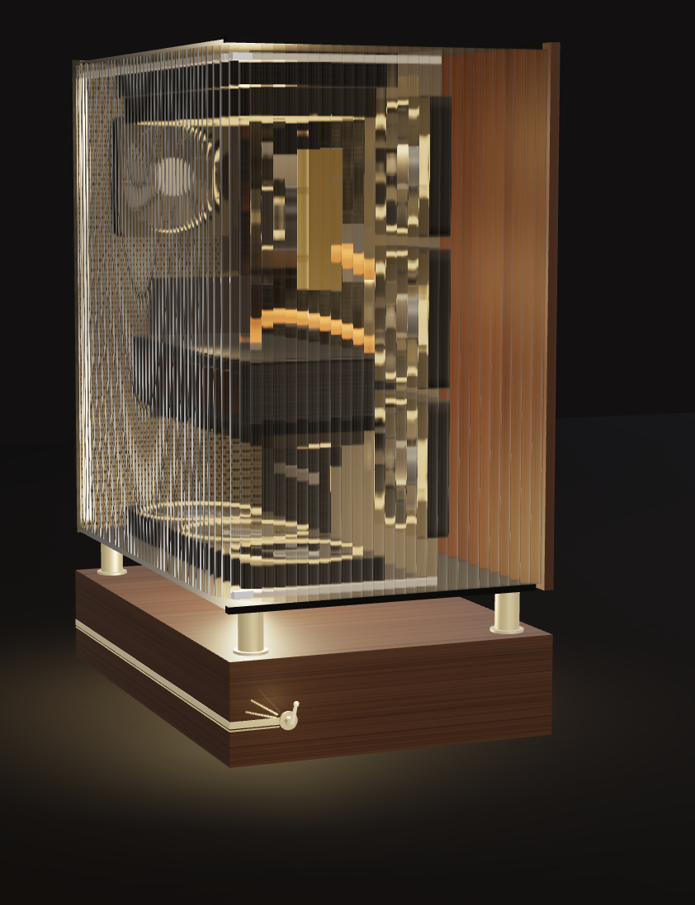
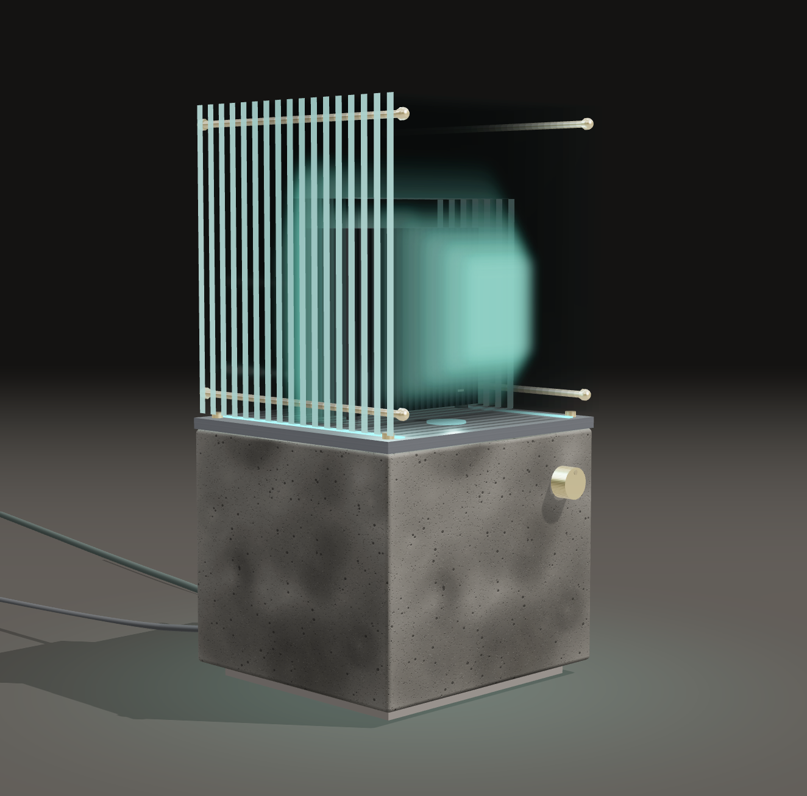
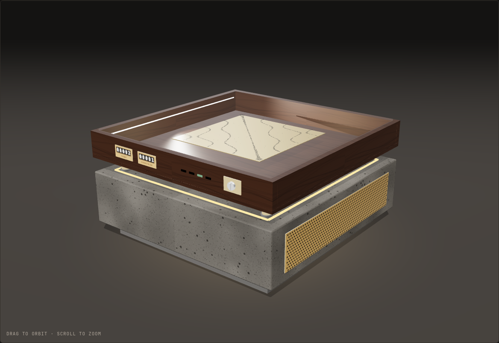
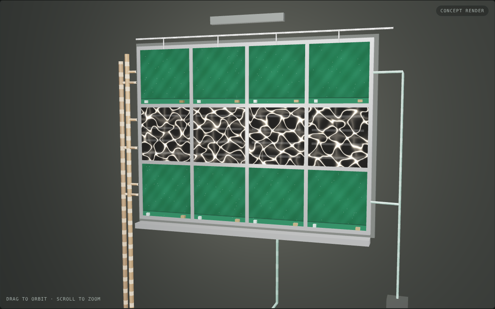
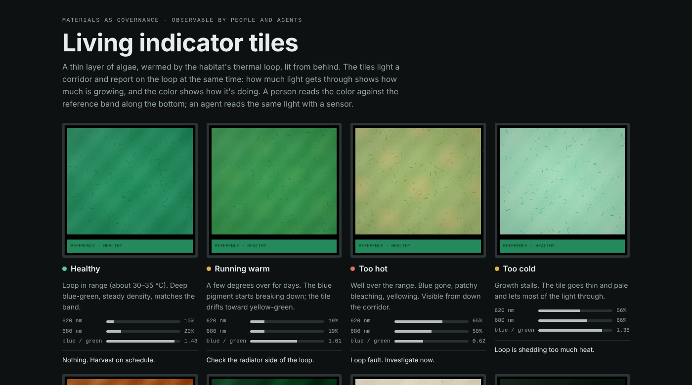

# ARKOS Open Builds

Open source builds from the ARKOS Lab, the hardware division of Current Futures Group. They're free to use, and we welcome your feedback.

ARKOS asks one question: **how do we live and work with technology when it's everywhere?** Each build is an experiment that tries an answer in a physical object.

## The two foundations

**Legibility by anyone.** A system's state should be readable by a person or a machine, without a manual and without taking the system's word for it.

**Dignity in design.** Respect for limited resources, for people and for organic materials. People and agents get equal standing.

[PRINCIPLES.md](PRINCIPLES.md) explains both. They're guidelines, not rules: each build applies at least one, and says which.

## Builds

| | Build | What it is | Start with |
|---|---|---|---|
|  | [The Float](builds/the-float/) | A gaming and modding PC built as furniture: reeded glass over gold fan light, floating on brass posts above a walnut block | `the-float-build-book.pdf` |
|  | [The Lantern](builds/the-lantern/) | A silent media player and lamp for beside the TV: tinted acrylic panes on a concrete base | `the-lantern-model.html`, then the build guide |
|  | [The Sand Table](builds/the-sand-table/) | Shows in sand how settled an AI agent was on its last task: crisp means settled, smeared means unsettled | `the-sand-table-desk-test.pdf`, then the build guide |
|  | [Living Light Wall](builds/living-light-wall/) | Wall tiles that grow food from waste heat and show the health of the system that heats them | `SPEC.md` |
|  | [Living Indicator Tiles](builds/living-indicator-tiles/) | Backlit algae tiles that light a corridor and report on a habitat's thermal loop | `living-indicator-tiles.html` |

Every page is a single HTML file that works offline: download it and open it in a browser. The Lantern and Sand Table models are also tools: choose your options, then use the buttons under the model to download the cut files, print files and software for your version.

## How to read a build

Every build folder follows the same layout ([template](builds/_template/README.md)):

- `README.md`: what it is, which principles it applies, its status and what's known to be wrong with it
- The model: an interactive 3D page, labelled as a render
- The guide or spec: how it works and how to build it
- `images/`: the pictures on the build's page
- A desk test: the cheapest experiment that could prove the idea wrong

**We label honestly.** A render is a render, a prediction is a prediction, and the guide says when something hasn't been tested.

## Use it, build it, tell us

- Build something from here? Open a [build report](../../issues/new?template=build-report.md). Failures are as useful as successes.
- Found a problem or a better way? Open an issue or a pull request. See [CONTRIBUTING.md](CONTRIBUTING.md).
- Want to change a model or regenerate a guide? The scripts are in [tools/](tools/README.md).

## Free to use

Everything here is given away under [CC0](LICENSE): copy it, change it, build it, sell it. No permission or credit needed, though credit is always welcome. These are experiments, provided as-is; read each build's safety notes.
