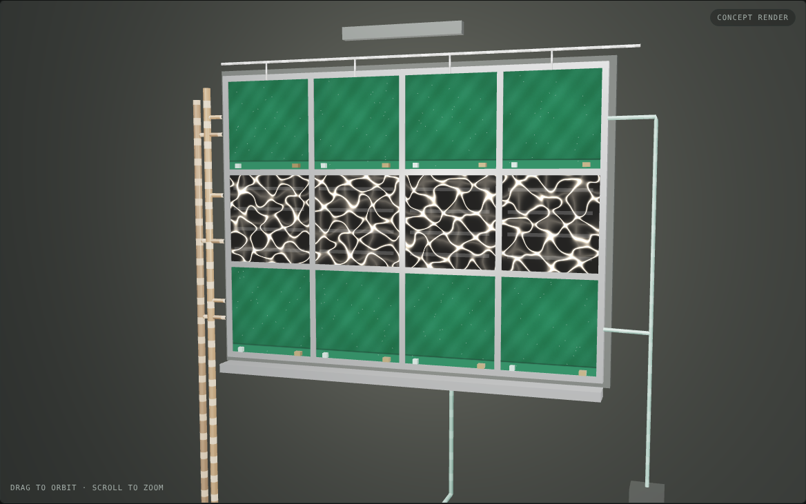
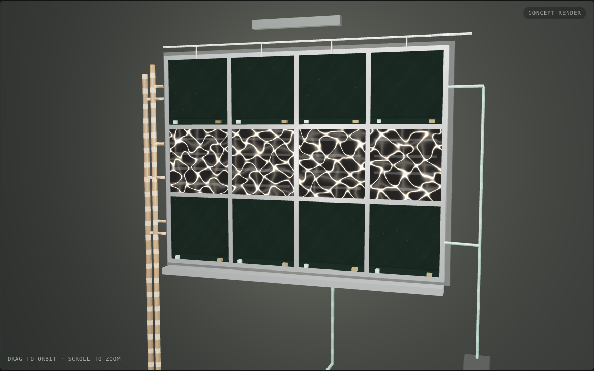
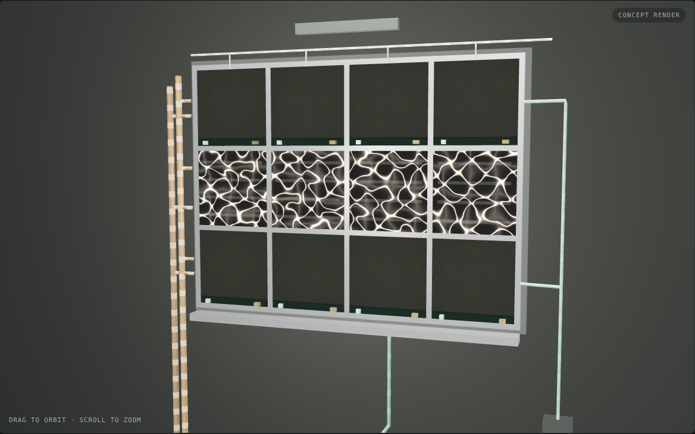
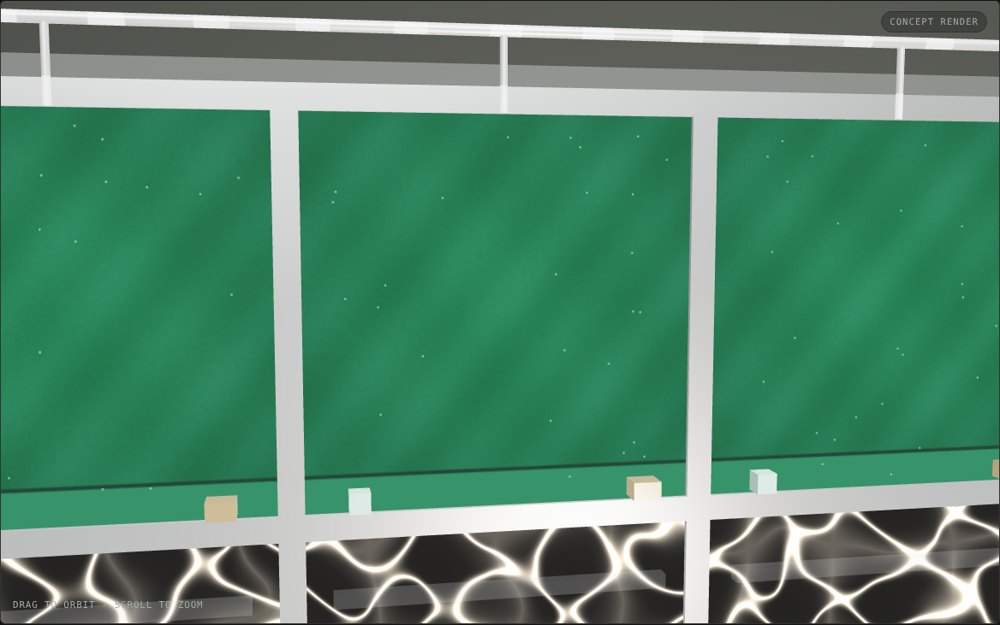
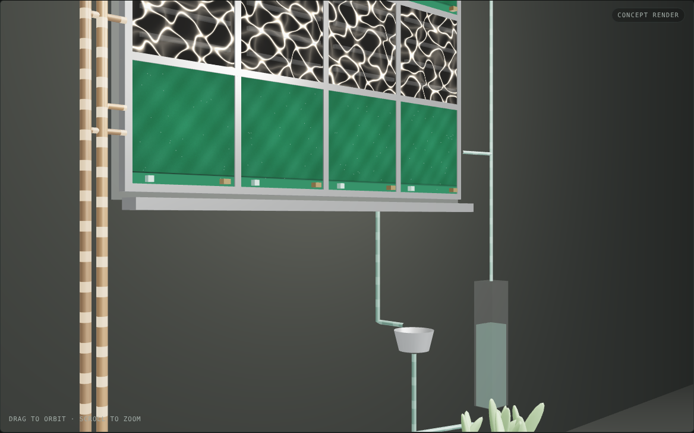

# Living Light Wall

Grow food from waste heat, while monitoring the health of your systems in a way that's beautiful and natural.

**Status:** Concept and desk tests. Nothing here has been built at full size yet.
**Principles applied:**
- Legibility by anyone: physics and biology show the state; no screens, no sensors.
- Dignity in design: it turns waste heat into food and oxygen, and its spent medium waters plants.

## What it shows

Two tile types share one frame:

| Tile | The question | How it shows it | Honest by |
|---|---|---|---|
| Flow | Is waste heat arriving? | Light ripples through a clear channel of loop water; still light means no flow | Physics |
| Grow | Is it sustaining life? | A backlit spirulina culture beside its healthy reference band | Biology |

Read together, the wall says: the heat is arriving, and it's sustaining life. Or it shows you which part isn't.

## Renders

Concept renders from the interactive model, not photos.

| At night | Too hot: the grow tiles show it | Close on the grow tiles | Where the water goes |
|---|---|---|---|
|  |  |  |  |

## Files

- [SPEC.md](SPEC.md): how it works, the plumbing, safety, and desk tests
- [living-light-wall-model.html](living-light-wall-model.html): interactive concept render. Change the loop's flow, the last few days, day and night, and harvest a tile. Works offline. It's a render, not a photo.

## Desk tests

Two cheap tests, one for each tile, in [SPEC.md](SPEC.md#desk-tests). The grow test takes about two weeks and doubles as time-lapse footage.

## Honest limits

- Colour isn't proof the food is safe to eat. See the safety section.
- At home scale, yield is small: a garnish and a demonstration, not a diet.
- Not an air purifier.
- Grow tiles need harvesting and refills every few days.
- Not yet tested in microgravity.

## Prior art

Sight glasses, algae façades and spirulina life-support research (for example ESA's MELiSSA) already exist. What's new is the combination: a readable record of a heat loop, and food, in one wall tile.
