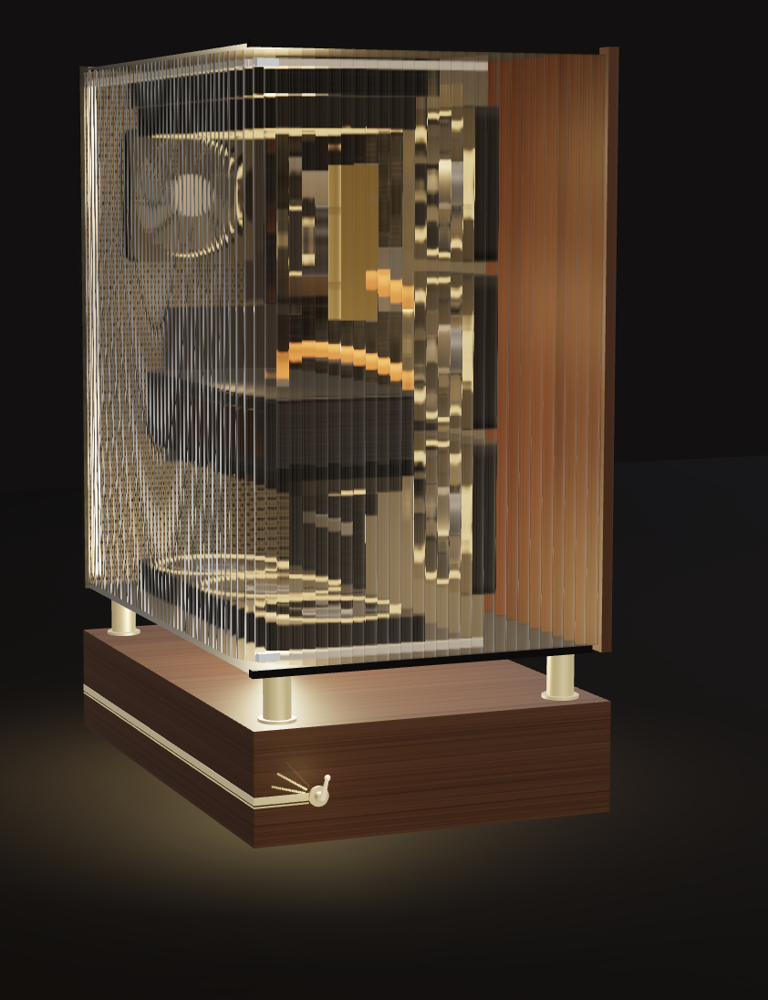
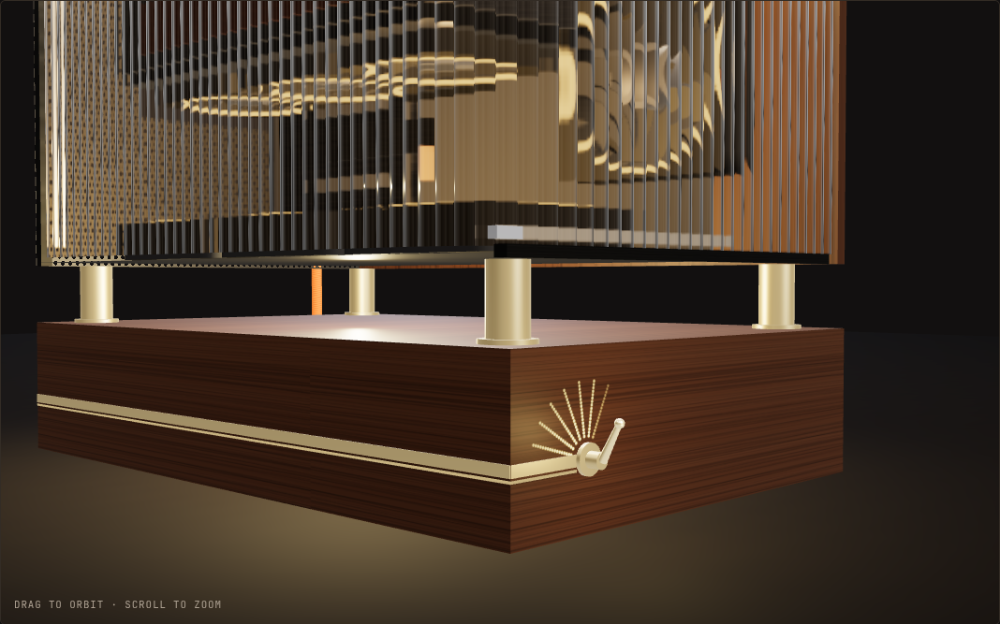
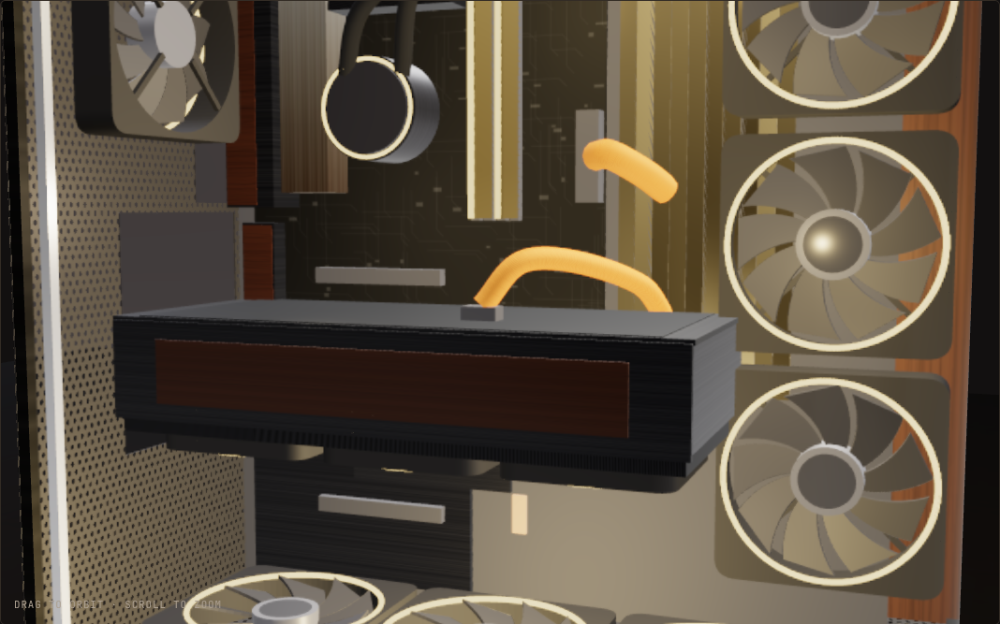
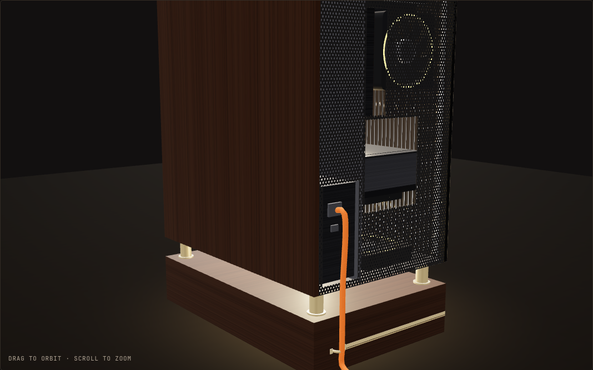
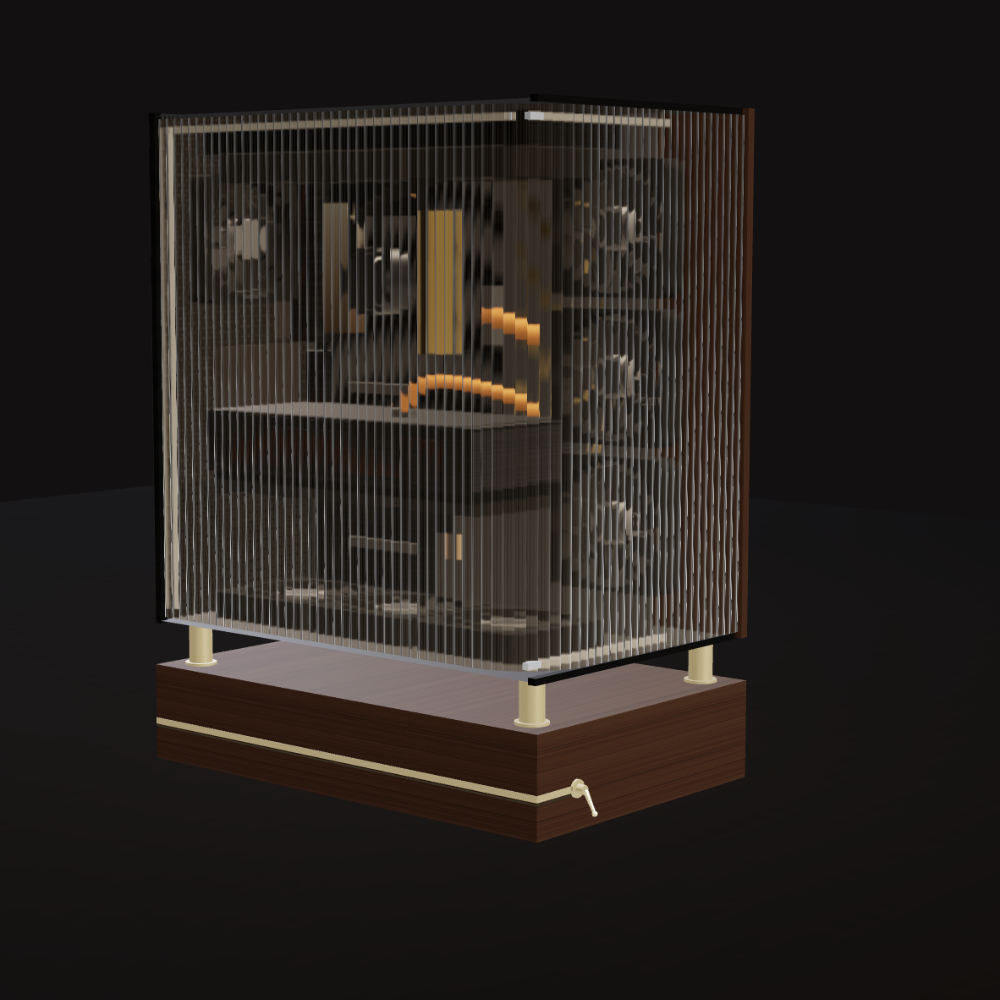
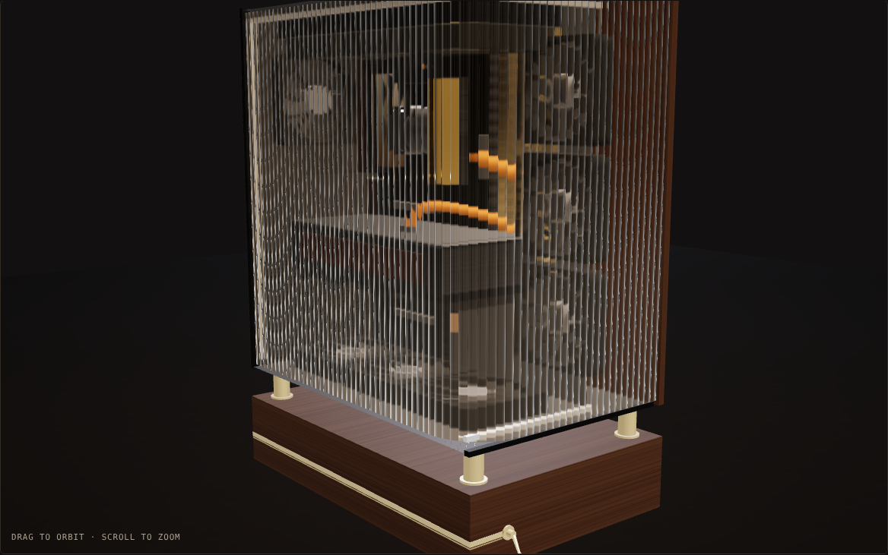
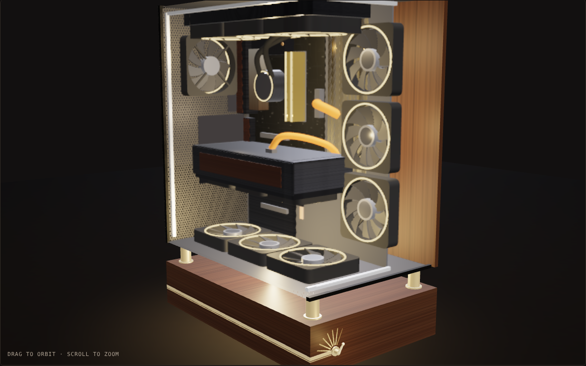

# The Float

A gaming and modding PC built as living-room furniture. An Antec C8 Curve Wood case, its curved glass wrapped in one reeded panel, floats 4 cm above a solid walnut block on four brass posts. Ten programmable fans glow gold behind the reeds, so you see the machine without quite seeing it. The bottom fans breathe through the gap, and their light spills out onto the walnut.

**Status:** Designed November 2026, not yet built.
**Principles applied:**
- Legibility by anyone: a lit seam under a brass inlay shows on, asleep and off, and a hidden fan of 12 rays in the walnut shows power draw, 50 W per ray.
- Dignity in design: every choice must be justified by airflow, touch or a named reference.

## Renders

Concept renders from the 3D model, not photos.

| The gap | Inside | The back |
|---|---|---|
|  |  |  |
| **The reeded wrap** | **Asleep** | **Glass clear, to inspect** |
|  |  |  |

## Files

| File | What it is |
|---|---|
| [the-float-build-book.html](the-float-build-book.html) | The build book with an interactive, to-scale 3D model: concept, design principles, parts list, swap checklist, how to make the custom pieces, safety, timeline |
| [the-float-build-book.pdf](the-float-build-book.pdf) | The same book, printable, with renders |
| [the-float-model.html](the-float-model.html) | The 3D model alone, with switches for the glass, fan colour and effect, power states and views |
| [float-base-spec.html](float-base-spec.html) | Shop spec for the walnut base, with dimensioned drawings, to hand to a woodworker |
| [float-base-spec.pdf](float-base-spec.pdf) | The same base spec, printable |
| [shopping-list.html](shopping-list.html) | Every part to buy, with prices, timing and links. Tick items as you buy them |
| [shopping-list.csv](shopping-list.csv) | The same list as a spreadsheet |
| [north-xl-model.html](north-xl-model.html) | Plan B: the same idea in a Fractal North XL (walnut slats, flat reeded side, slotted base) |
| [2026-11-15-house-build-design.md](2026-11-15-house-build-design.md) | The first-pass design log (North XL version), kept for the reasoning behind each choice |

Open the HTML files in a browser; the 3D models need an internet connection to load three.js. The models are renders, not photos.

## The ideas worth stealing

- **See without quite seeing.** Reeded film on the glass turns hardware into bands of light and shape.
- **Let the gap breathe.** Raise a bottom-intake case on posts, and the gap becomes the air intake and a light feature, so the base needs no vents.
- **Every part earns its brass.** The posts carry weight; one is hollow and carries the switch wires; a brass clip holds the cord; a brass toggle switches the PC on through a tiny controller.
- **Light reports the machine.** The seam and the rays tell you what the PC is really doing, even after a crash or a keyboard wake.

## Honest limits

- Prices and parts are from November 2026 and change daily.
- Confirm the case's top radiator support before buying a 360 mm cooler.
- Apply reeded film with the glass off the case, never inside the assembled PC.
- The renders still show the graphics card's power cable in amber. The book now uses the power supply's own stock cable for it, for safety; both 3D models show it black.
- Product names belong to their makers; nothing here is sponsored.
