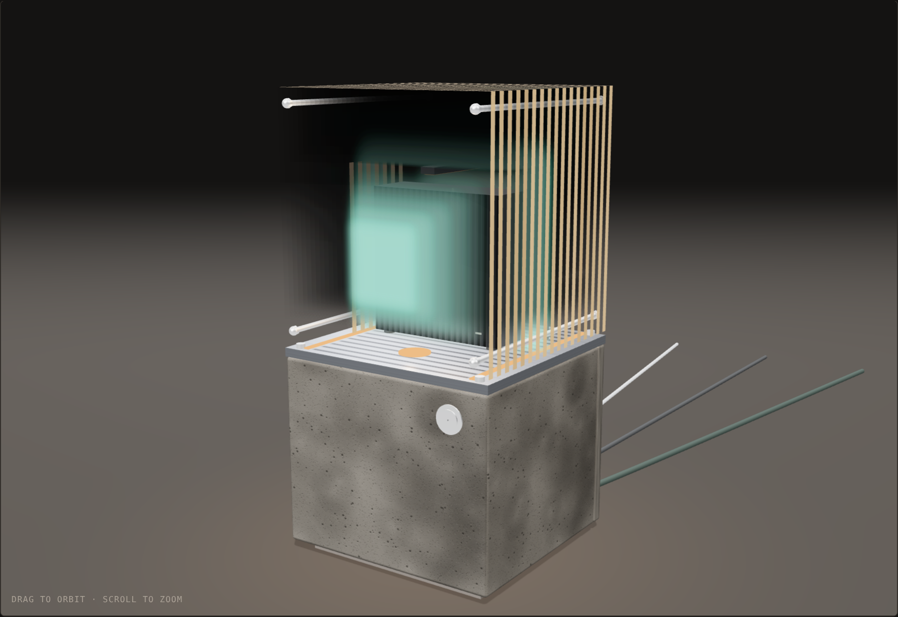
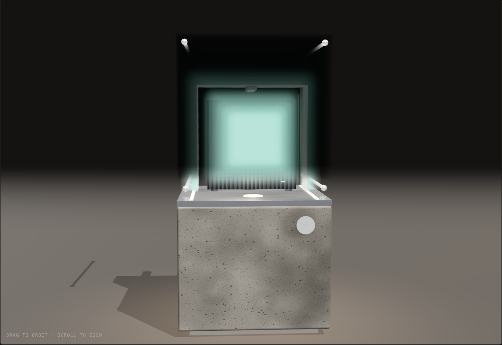
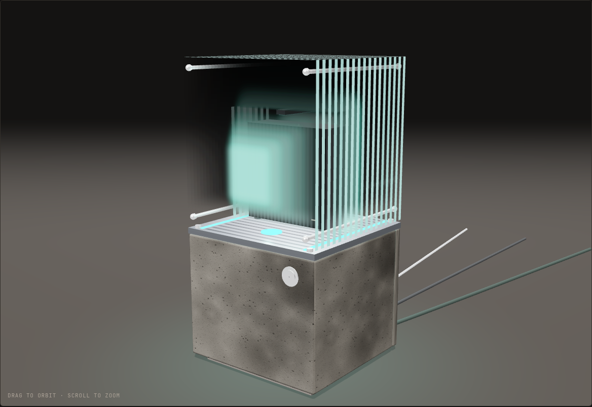
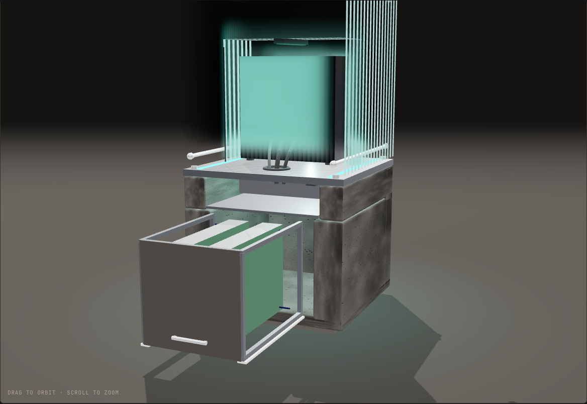
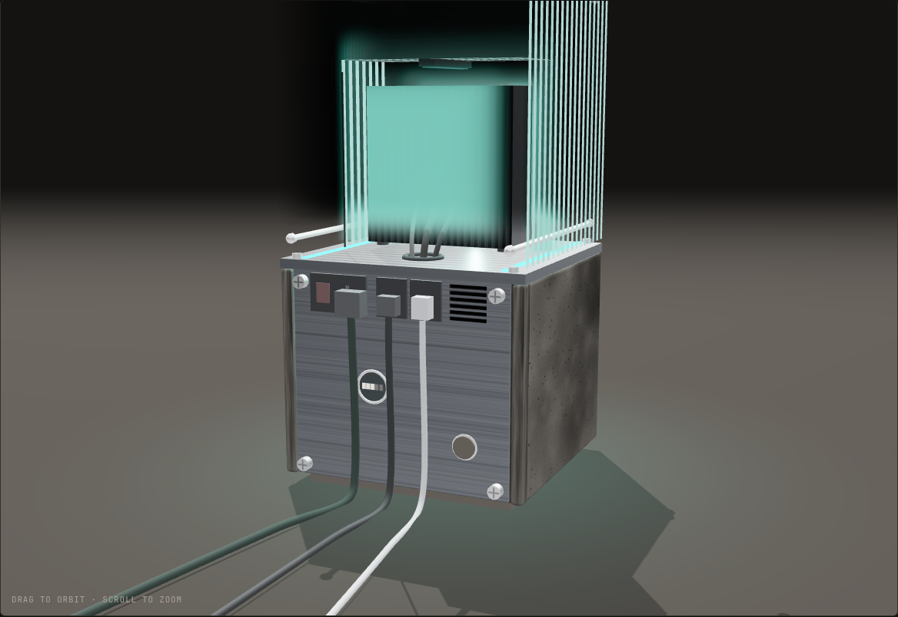

# The Lantern

A home media server you'd want in the living room: a silent, fanless computer and two drives inside a block of tinted acrylic panes on a cast concrete base. It doubles as a lamp beside the TV.

**Status:** Designed; build guide complete; not yet built.
**Principles applied:**
- Dignity in design: the computer is treated as furniture, silent and beautiful, made of honest materials (glass, concrete, felt, brushed metal). It opens from the back so drives can be pulled and parts repaired.
- Legibility by anyone: the light shows the machine's state (off, lamp, evening, colour, asleep).

## Renders

Concept renders from the interactive model, not photos.

| Lamp, from the front | Colour mode | Drives pulled | The back |
|---|---|---|---|
|  |  |  |  |

## Files

- [the-lantern-model.html](the-lantern-model.html): **start here.** The interactive 3D model, and the tool that makes the build files. Choose the glass and film colours, then press:
  - **Cut files:** DXF for the acrylic and aluminium shops, plus an order sheet.
  - **Print files:** the 17 pane prints at true size, plus print notes.
- [the-lantern-build-guide.pdf](the-lantern-build-guide.pdf) / [.html](the-lantern-build-guide.html): step by step. Parts and sourcing links, drawings, glass, metal, concrete, electronics, software, assembly and tests.

Every page works offline.

## In short

- 17 acrylic panes, each darker toward the centre, with a window cut around a fanless mini PC.
- Cast concrete base holding a sound-sealed drive vault, with cables dropping through a channel inside the base.
- One 12 V supply runs everything; light is set by a single knob.
- About 4–6 weeks, mostly waiting on shops and concrete.

## Desk test

Before printing all 17 panes, cut three spares, print one with the tint and square, and hold it over an LED strip in a dark room. If the glow doesn't read the way the model shows, adjust the tint first.

## Honest limits and safety

- Mains wiring and earth bonds should be checked by someone experienced.
- The drive vault is sealed for sound, so heat must leave through the heat pads and lid. Check drive temperatures during the first long copy (under 50 °C).
- Lift it by the base, never by the glass.
- Prices are from November 2026 and change often.
