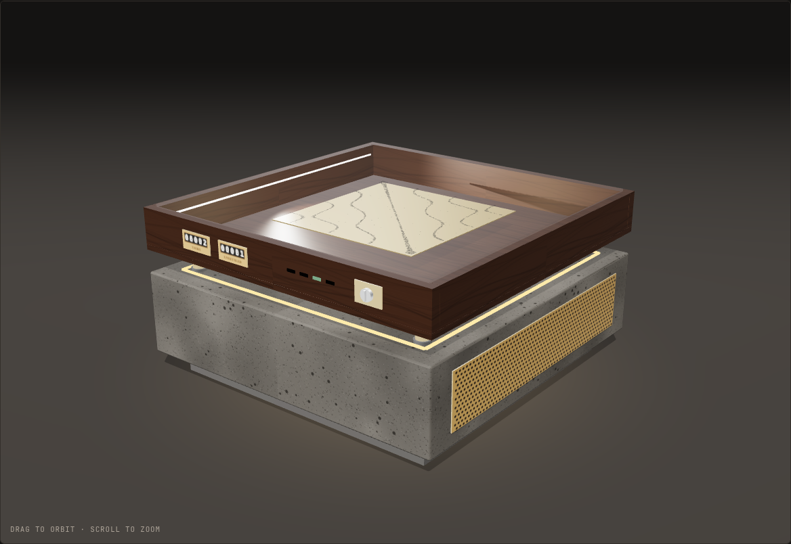
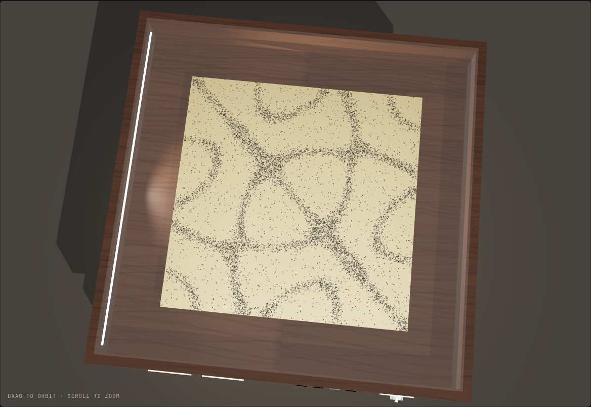
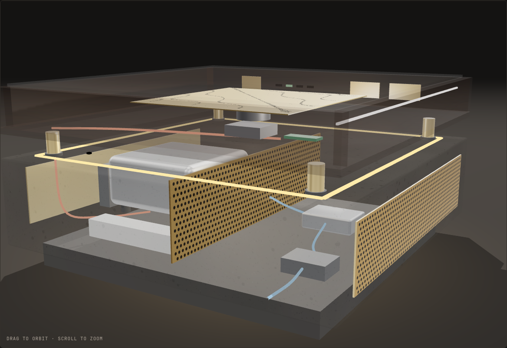

# The Sand Table

Shows, in sand, how settled an AI agent was when it finished its last task. The agent's computers sit in a concrete body, with a tray of sand floating above on brass posts. When a task ends, the brass plate rings and the sand jumps into a figure: crisp if the agent was settled, smeared if it was unsettled. The figure stays until the next task.

**Status:** Designed; desk test next.
**Principles applied:**
- Legibility by anyone: the sound and the figure are the same vibration of the same plate, so they can't disagree.
- Honesty: the reading comes from the model's internals, never from the agent's own account of itself.

## Renders

Concept renders from the interactive model, not photos. The figures are idealised drawings, not simulations.

| Settled, from above | Unsettled, from above | Inside the body |
|---|---|---|
|  |  |  |

## Files

- [the-sand-table-desk-test.pdf](the-sand-table-desk-test.pdf) / [.html](the-sand-table-desk-test.html): **start here.** One afternoon at a kitchen table, about $150–300, with tables to fill in at the bench. It decides the plate size, driver, volume and whether the blur reads.
- [the-sand-table-model.html](the-sand-table-model.html): the interactive 3D model, and the tool that makes the build files. Set the plate size from your desk test, then press:
  - **Cut files:** brass plate, glass, vents, divider, hatch, placard, plus an order sheet.
  - **Software:** the meter, the controller firmware, setup for the Mac and the agent box, and the smaller versions.
- [the-sand-table-small-versions.pdf](the-sand-table-small-versions.pdf) / [.html](the-sand-table-small-versions.html): two cheaper versions that keep the core. **Tier 1, the kitchen table** (about $120–220): one computer plays the plate itself, for classrooms, workshops and booths. **Tier 2, the honest version** (about $300–500): the agent on its own Raspberry Pi and a one-way wire to the plate. Each says what it gives up, with a placard to print.
- [the-sand-table-build-guide.pdf](the-sand-table-build-guide.pdf) / [.html](the-sand-table-build-guide.html): step by step, starting with the desk test.
- [software/](software/): the same software as plain files: the meter, the controller firmware, and step-by-step setup for each machine.
- [WATER-VERSION.md](WATER-VERSION.md): a variant with water in a glass tray, projecting the pattern onto the ceiling.

Every page works offline.

## How it works

Three machines, three jobs, and they never share one:

- **Agent box (Raspberry Pi 5):** the agent, its tools and its files. It thinks by asking the Mac.
- **Mac Studio:** the model and the meter, nothing else. There's no account for the agent.
- **Controller (Raspberry Pi Pico, no radio, in the tray):** turns one number into the sand figure. It listens and never talks back.

The meter is arithmetic: for every reply, it looks at how spread the model's choices were over its shakiest words. A task's number is its worst reply, so one torn step can't hide inside a confident task. The number goes up a hollow brass post over a one-way wire. The household's figure is chosen at setup from the figures its own plate can make.

The front edge has a key (sealed, online, act), four telltales, and two counters that only count up: tasks, and unsettled tasks.

## Honest limits

- **Settled isn't the same as right.** The figure shows how the model behaved, not whether its work was correct. The meter's log has a column for a person to mark whether each task was actually right.
- Loudness is the biggest livability question.
- Whether the blur reads clearly from across a room is untested.
- Tool calls may read too settled: their fixed parts (brackets, field names) are forced by the format. The shakiest-10% rule should handle it; the log's `tool_calls` column shows whether tool-heavy tasks come out crisper than they deserve.
- The meter is tested against a stand-in model server, not yet a real one; the firmware hasn't been compiled yet.

## Feedback wanted

The build guide ends with questions for reviewers. Answer any of them in a [build report](../../../../issues/new?template=build-report.md) or an issue.
